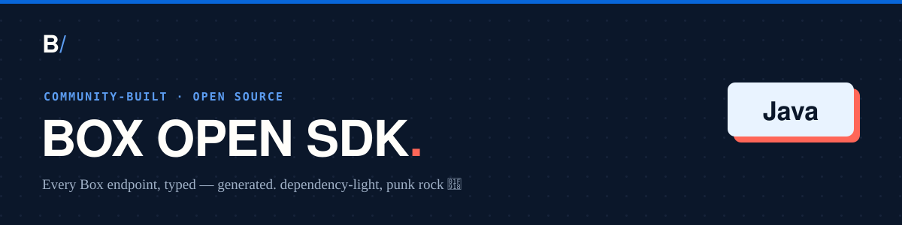

<!-- Generated by box-gantry. DO NOT EDIT. -->


# box-open-sdk (Java)

[](https://github.com/unofficialbox/box-open-java-sdk/releases/latest)
[](https://central.sonatype.com/artifact/dev.unofficialbox/box-open-sdk)
[](https://javadoc.io/doc/dev.unofficialbox/box-open-sdk)
[](LICENSE)

An **open source, community-built** Box API client for Java — one resource manager per
API area behind a single `dev.unofficialbox.Client`, over a dependency-free
`java.net.http` runtime with retry, backoff, and token refresh.

> **Not affiliated with, authorized, or endorsed by Box, Inc.** "Box" is a
> trademark of Box, Inc. This is an independent, generated client.

## Install (Maven)

```xml
<dependency>
  <groupId>dev.unofficialbox</groupId>
  <artifactId>box-open-sdk</artifactId>
  <version>0.9.0</version>
</dependency>
```

## Quickstart

Authenticate, look up the current user, create a folder, upload a file, extract
its fields with Box AI, tag it with metadata, and query for it — end to end.
Request bodies use fluent builders:

```java
import dev.unofficialbox.Client;
import dev.unofficialbox.auth.Auth;
import dev.unofficialbox.runtime.Runtime;
import dev.unofficialbox.model.schemas.*;
import java.util.List;
import java.util.Map;

public final class Quickstart {
    public static void main(String[] args) throws Exception {
        // Client Credentials Grant (server-to-server); developer token, OAuth,
        // and JWT also live in dev.unofficialbox.auth.Auth.
        var client = new Client(Auth.clientCredentials(
            Runtime.CcgConfig.enterprise("CLIENT_ID", "CLIENT_SECRET", "ENTERPRISE_ID")));

        // The current user.
        var me = client.users.getMe(null);
        System.out.println("authenticated as " + me.id());

        // Create a folder at the account root ("0").
        var folder = client.folders.create(
            CreateFolderRequest.builder()
                .name("Invoices")
                .parent(AttributesParent.builder().id("0").build())
                .build(),
            null);

        // Upload a file into it.
        var uploaded = client.uploads.uploadFile(
            CreateFileContentRequest.builder()
                .attributes(PostFileContentAttributes.builder()
                    .name("invoice.pdf")
                    .parent(AttributesParent.builder().id(folder.id()).build())
                    .build())
                .file("<file bytes>".getBytes())
                .build(),
            null);
        var fileId = uploaded.entries().orElseThrow().get(0).id();

        // Extract fields from the file with Box AI.
        var answer = client.ai.extract(
            AiExtract.builder()
                .prompt("Extract the invoice number and total amount.")
                .items(List.of(
                    AiItemBase.builder().id(fileId).type(AiCitationType.FILE).build()))
                .build());
        System.out.println(answer);

        // Attach that metadata to the file (an enterprise template).
        client.fileMetadata.createFileMetadata(
            fileId,
            GetFileIdMetadataIdScope.ENTERPRISE,
            "invoiceData",
            Map.of("invoiceNumber", "INV-0042", "total", 1250));

        // Query for files carrying that metadata.
        var results = client.search.queryByMetadata(
            MetadataQuery.builder()
                .from("enterprise_0.invoiceData")
                .ancestorFolderId(folder.id())
                .build());
        System.out.println(results);
    }
}
```

## Parallel chunked upload

`BoxChunkedUpload` uploads a large file's parts **in parallel** on virtual
threads — no flags needed:

```java
var file = new dev.unofficialbox.BoxChunkedUpload(client)
        .upload(bytes, "large.bin", folderId);
```

### Structured concurrency (opt-in preview)

`BoxStructuredChunkedUpload` does the same with structured concurrency, a Java
**preview** API. Code that uses it passes `--enable-preview` at **both** compile
and run time (`javac --release 26 --enable-preview …`, `java --enable-preview …`).
A preview class only loads on the JDK release it was compiled for (26); the
default class has no such limit.

## HTTP versions

API requests prefer HTTP/3: the first request goes over HTTP/2 and later ones
upgrade once Box advertises HTTP/3 (`Alt-Svc`), falling back to HTTP/2 or
HTTP/1.1. Pick another preference on a configured session:

```java
var session = Runtime.Session.builder(auth)
    .httpVersion(java.net.http.HttpClient.Version.HTTP_2)
    .build();
var client = new Client(session);
```

The builder also takes `maxRetries`, default headers, base URLs, or your own
`HttpClient` (which carries its own version — set one or the other). Token
requests keep their own client.

## Documentation

The [`docs/`](./docs) tree carries the per-manager reference — a call snippet for
every method — and the authentication, pagination, and errors guides.
